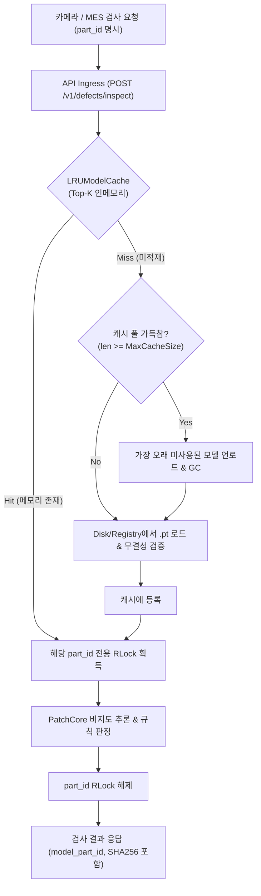

# 다품종 혼류 생산 라인을 위한 ModelRegistry + LRUModelCache 확장 아키텍처 설계

**작성일:** 2026-11-06  
**프로젝트:** POSCO AI 해커톤 (스틸가디언 팀)  
**대상 시스템:** PatchCore 비지도 이상탐지 다품종 실시간 검사 플랫폼  

---

## 1. 개요 및 현재 버전의 운영 한계 (Limitations of Current Version)

### 1.1 현재 시스템 아키텍처 및 전제 조건
- **단일 활성 모델 (Single Active Model):** 현재 배포된 POSCO AI 스마트팩토리 검사 시스템은 단일 라인에서 단일 규격의 부품(예: `metal_nut`)을 연속 검사하는 단일 활성 모델(`_ACTIVE_ENGINE`) 전제로 구현되었습니다.
- **원자적 핫스왑 (Atomic Hot-Swap):** `POST /v1/models/activate`를 통해 무중단으로 신규 부품 모델을 활성화할 수 있으나, 활성화 시 전역 락(`_ENGINE_LOCK`)을 획득하여 단 하나의 모델만 메모리에 교체 적재합니다.
- **해커톤 데모 검증 범위:** 해커톤 데모에서는 단일 활성 모델 기준의 초당 검사 수량(UPH), 추론 지연 시간(CPU 평균 103.4ms, P95 112.5ms), 단일 컨베이어 벨트 스트리밍 환경에서만 성능을 검증했습니다.

### 1.2 다품종 혼류 라인(Multi-Part Mixed Line) 적용 시의 한계
제철소 후판/선재/압연 공정에서 서로 다른 규격의 부품(예: M12 볼트, M16 너트, 롤러 베어링 등)이 동일 컨베이어 또는 인접 멀티 라인에서 동시에 유입되는 경우 다음과 같은 병목이 발생합니다:
1. **Lock 대기 병목:** 검사 요청마다 `part_id`가 변경될 때마다 모델을 디스크에서 다시 읽거나 교체 락을 대기하면서 P95 레이턴시가 급증합니다.
2. **단일 프로세스 메모리 누적/경합:** 여러 모델을 무제한 메모리에 올려둘 경우 RAM/VRAM 메모리 부족(OOM) 위험이 발생합니다.
3. **대시보드-서버 간 상태 불일치(State De-sync):** 멀티 클라이언트가 동시에 서로 다른 부품을 요청할 때 단일 활성 모델 방식으로는 처리할 수 없습니다.

---

## 2. 확장 아키텍처: ModelRegistry + LRUModelCache

다중 라인 동시 검사를 위해 **요청 기반 부품 지정(`part_id`)**과 **LRU(Least Recently Used) 인메모리 모델 캐시** 구조를 제안합니다.



---

## 3. 세부 설계 사양

### 3.1 LRUModelCache 인터페이스
```python
import threading
from collections import OrderedDict
from pathlib import Path
from patchcore_engine import PatchCoreEngine

class LRUModelCache:
    """
    Top-K 부품 모델을 인메모리에 유지하며, 모델별 세밀한 RLock을 제공하는 스레드 안전 캐시
    """
    def __init__(self, max_models: int = 5, models_dir: Path = Path("models")):
        self.max_models = max_models
        self.models_dir = models_dir
        self._cache: OrderedDict[str, PatchCoreEngine] = OrderedDict()
        self._locks: dict[str, threading.RLock] = {}
        self._global_lock = threading.RLock()

    def get_engine_and_lock(self, part_id: str) -> tuple[PatchCoreEngine, threading.RLock]:
        with self._global_lock:
            # 1. 모델별 락 생성 보장
            if part_id not in self._locks:
                self._locks[part_id] = threading.RLock()
            lock = self._locks[part_id]

            # 2. 캐시 히트: 가장 최근 사용(MRU)으로 이동
            if part_id in self._cache:
                self._cache.move_to_end(part_id)
                return self._cache[part_id], lock

            # 3. 캐시 미스: 용량 초과 시 LRU 모델 축출(Eviction)
            if len(self._cache) >= self.max_models:
                evicted_id, _ = self._cache.popitem(last=False)
                # 필요 시 명시적 리소스 해제

            # 4. 신규 모델 로드 및 등록
            target_pt = self.models_dir / f"{part_id}.pt"
            engine = PatchCoreEngine(model_path=target_pt)
            self._cache[part_id] = engine
            return engine, lock
```

### 3.2 API 스펙 확장 제안

#### 검사 요청 (POST /v1/defects/inspect)
- **추가 파라미터:** `part_id: str = Form("metal_nut_default")` (또는 헤더 `X-Part-ID: metal_nut_default`)
- **동작 방식:**
  1. 클라이언트가 검사할 부품의 `part_id`를 명시합니다.
  2. 서버는 `LRUModelCache`에서 해당 `part_id` 엔진과 전용 락을 가져옵니다.
  3. 다른 `part_id` 요청(예: 라인1의 `metal_nut`과 라인2의 `bearing_m20`)은 **서로 다른 락**을 사용하므로 **완전 병렬로 동시 추론**됩니다.
  4. 동일 `part_id`에 대해서만 락 경합이 발생하여 안전성을 유지합니다.

---

## 4. 운영 관측성(Observability) 및 모니터링 지표 정의

다품종 라인 안정 운영을 위해 Prometheus / MES로 수집해야 하는 핵심 모니터링 항목:

| 지표명 | 메트릭 유형 | 단위 | 임계 기준 (SLA) | 설명 |
| :--- | :---: | :---: | :---: | :--- |
| `inspection_p95_latency_ms` | Histogram | ms | < 50ms | 부품별 P95 추론 지연 시간 |
| `model_lock_wait_seconds` | Histogram | ms | < 5ms | 모델별 RLock 획득 대기 시간 (병목 감지) |
| `lru_cache_hit_ratio` | Gauge | % | > 95% | LRU 인메모리 캐시 히트율 (미스 시 로드 지연 발생) |
| `throughput_qps_by_part` | Counter | QPS | 부품별 상이 | 각 부품 규격별 초당 검사 요청 수 |
| `system_memory_rss_bytes` | Gauge | MB | < 8,000MB | 서버 프로세스 전체 RAM/VRAM 점유율 |
| `model_eviction_total` | Counter | 건 | 최소화 권장 | 캐시 용량 부족으로 인한 모델 축출 빈도 |

---

## 5. 단계별 마이그레이션 로드맵

1. **Phase 1 (해커톤 데모 - 현재 완료):** 단일 라인, 1개 활성 모델 핫스왑, SHA256 체크섬 무결성, Zero-Leakage 검증
2. **Phase 2 (시범 혼류 라인):** `LRUModelCache(max_models=3)` 도입, 요청 단위 `part_id` 지정, 부품별 세분화 Lock 적용
3. **Phase 3 (전사 스마트팩토리 양산):** Triton Inference Server 기반 동적 모델 레지스트리 및 멀티 GPU 풀 배치 추론 클러스터 확장
